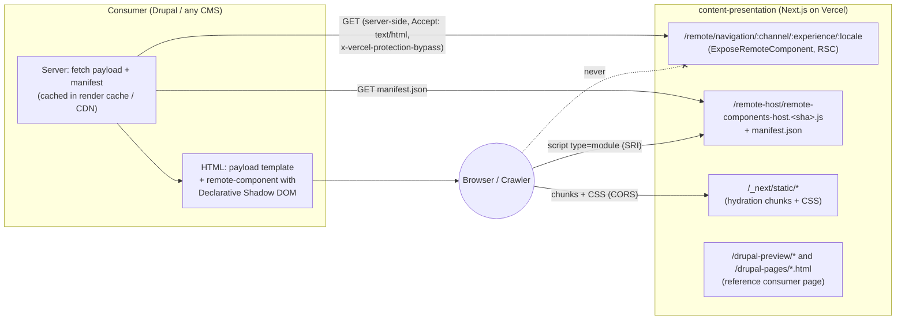
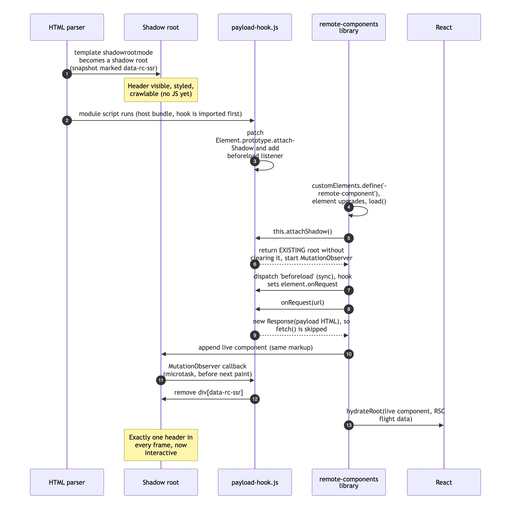
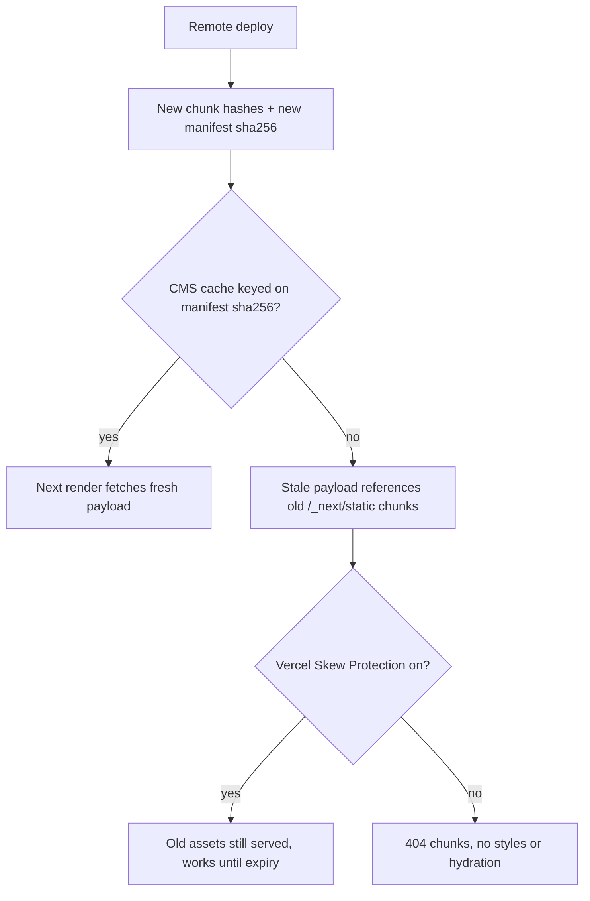

# Remote Navigation: Server-Rendered Delivery to Non-Next.js Hosts

How the header navigation built in `content-presentation` is delivered to a legacy CMS
(e.g. Drupal) so that it is:

- **server-rendered**: real, styled, crawlable HTML in the first response, with no JavaScript required;
- **free of client-side remote calls**: the browser never calls `/remote/navigation/*`;
- **free of library installs for consumers**: one prebuilt ESM script;
- **isolated**: Shadow DOM keeps the header's CSS out of the host page and the host's CSS out of the header;
- **versioned and cache-busted automatically**: a content-hashed bundle plus a manifest.

> [!NOTE]
> Brand and domains in this repo are generic placeholders (`APEX`, `company.com`). Replace them per environment via env variables (see [DEPLOYMENT.md](../DEPLOYMENT.md)).

---

## 1. Big picture



| Piece | File | Role |
| --- | --- | --- |
| Remote fragment | `app/remote/navigation/[channel]/[experience]/[locale]/page.tsx` | Renders `HeaderNavigation` wrapped in `<ExposeRemoteComponent>`; `noindex, follow` |
| Host bundle build | `scripts/build-remote-host.mjs` | Bundles `remote-components/host/html` + React + payload hook into `public/remote-host/` |
| Payload hook | `scripts/remote-host/payload-hook.js` | Serves inlined payloads via `onRequest`; Declarative Shadow DOM handoff |
| Bundle entry | `scripts/remote-host/entry.js` | Imports the hook **before** the host, exposes `window.RemoteComponentsHost` |
| Page renderer | `scripts/remote-host/payload-page.mjs` | Shared: fetch payload, extract SSR markup, render embed + page |
| Runtime preview | `app/drupal-preview/[[...flavour]]/route.ts` | Reference consumer page rendered on request |
| Static generator | `scripts/generate-remote-payload-pages.mjs` | Same pages as static files (QA snapshots) |
| URL aliases | `next.config.ts` → `rewrites().beforeFiles` | `/drupal-pages/*.html` → `/drupal-preview/*` |
| CORS / caching | `next.config.ts` → `headers()` | Cross-origin access for `/remote/*`, `/remote-host/*`, `/_next/static/*` |

All paths are relative to `apps/content-presentation/`.

---

## 2. The host bundle (no library install for consumers)

`pnpm run build` and `pnpm run dev` run `scripts/build-remote-host.mjs` before Next.js.

```text
public/remote-host/                     (gitignored, rebuilt every build)
├── remote-components-host.<sha8>.js              production, minified, immutable
├── remote-components-host.<sha8>.js.map
├── remote-components-host.development.<sha8>.js  React dev build (for `next dev` remotes)
├── remote-components-host.development.<sha8>.js.map
├── remote-components-host.js                     stable alias of production (short TTL)
├── remote-components-host.js.LEGAL.txt
└── manifest.json
```

`manifest.json` (abridged):

```json
{
  "name": "remote-components-host",
  "version": "0.4.16+0.1.0",
  "library": { "name": "remote-components", "version": "0.4.16", "entry": "remote-components/host/html" },
  "react": "19.3.0",
  "file": "remote-components-host.e98f6725.js",
  "sha256": "…",
  "integrity": "sha384-…",
  "variants": {
    "production":  { "file": "remote-components-host.e98f6725.js", "integrity": "sha384-…" },
    "development": { "file": "remote-components-host.development.3aaf8661.js", "integrity": "sha384-…" }
  },
  "gitSha": "…",
  "builtAt": "…"
}
```

Key behaviours:

- **Content-hashed filenames** are served with `Cache-Control: immutable`; `manifest.json` and the alias with a short TTL. Consumers read the manifest server-side and stamp `src` + `integrity`, so every release busts caches automatically.
- **Two variants**: React's production build cannot hydrate a `next dev` payload (its debug rows cause React error #504). Renderers detect `"b":"development"` in the payload and pick `variants.development`.
- **Atomic output**: the script builds into `public/.remote-host-build-<pid>/` and swaps the folder into place, so a running server never sees a half-written folder and concurrent builds (e.g. two `pnpm dev`) can't break each other.

---

## 3. The two `<template>` tags

Each embedded header produces this markup:

```html
<!-- ① Hydration payload: inert storage, never displayed -->
<template id="rc-payload-web-general-zh-Hant"
          data-remote-component-payload
          data-src="https://remote.example/remote/navigation/web/general/zh-Hant">
  <!DOCTYPE html><html>…full remote response: markup + RSC flight data + chunk scripts…</html>
</template>

<!-- ② Host element with Declarative Shadow DOM (what users and crawlers see) -->
<remote-component src="https://remote.example/remote/navigation/web/general/zh-Hant"
                  payload="rc-payload-web-general-zh-Hant">
  <template shadowrootmode="open">
    <link rel="stylesheet" href="https://remote.example/_next/static/…css" data-rc-ssr>
    <div data-rc-ssr>
      <div id="enterprise-header-navigation">…all header links, no &lt;script&gt;…</div>
    </div>
  </template>
</remote-component>
```

| | ① Payload `<template>` (sibling) | ② `<template shadowrootmode="open">` (child) |
| --- | --- | --- |
| Purpose | Data for hydration | Server-rendered output |
| Contents | Full remote response including scripts and flight data | Stylesheet links + header markup, scripts stripped |
| Rendered | Never | Immediately, while the HTML is parsed |
| Crawlable | No (template contents are inert) | Yes (real DOM) |
| Consumed by | The payload hook (`onRequest`) | The browser's HTML parser |

### Declarative Shadow DOM in one paragraph

When the HTML parser meets `<template shadowrootmode="open">` as an element's child, it
**attaches a shadow root to that element and moves the template's contents into it**; the
`<template>` element itself disappears. No JavaScript is involved. Browsers and Googlebot
build the same DOM, so the header is visible, styled (the `<link>` loads inside the shadow
root), isolated, and its links are crawlable on the first response. In DevTools you'll see
`#shadow-root (open)` under `<remote-component>`; the `<template>` only appears in View Source.

### Why two copies?

Hydration needs the RSC flight data and the chunk-loading scripts. Executable scripts must
not run in the host page, so they're stripped from the visible copy (②) and kept as inert
text in the payload (①). Brotli compression on Vercel removes most of the size overhead.

---

## 4. Runtime sequence



### Payload hook details (`scripts/remote-host/payload-hook.js`)

**Serving the payload.** The library calls
`fetchWithHooks(url, init, { onRequest, onResponse })`, and if `onRequest` resolves to a
`Response`, it skips `fetch()`. The library dispatches a synchronous, bubbling `beforeload`
event right before that, and the hook (listening on `document` in the capture phase) attaches `onRequest`
there. Lookup order:

1. `payload="<template-id>"` on the element, honoured only while the template's `data-src` matches the current `src`;
2. any `template[data-remote-component-payload][data-src="<resolved src>"]`;
3. `window.RemoteComponentsHost.registerPayload(src, html)`.

If nothing matches, `onRequest` returns `undefined` and the library fetches normally, so a
client-side `src` change to a flavour that wasn't inlined still works. A consumer-defined
`onRequest` is never overwritten.

**Declarative Shadow DOM handoff.** Two problems are solved:

1. Per spec, `attachShadow()` on a declarative shadow root **removes all of its children**, so the
   header would blink out. The hook patches `attachShadow` and, for `<remote-component>` hosts
   containing a `data-rc-ssr` snapshot, returns the existing root untouched.
2. The library appends its own copy of the component. A `MutationObserver` sees it arrive and
   removes `div[data-rc-ssr]` in the same microtask, before the browser paints, so no frame ever
   shows zero or two headers. The snapshot's `<link data-rc-ssr>` stays (same URL the library uses).

### SSR extraction details (`extractSsrMarkup()` in `payload-page.mjs`)

From the remote response it:

- keeps `<link rel="stylesheet">` tags, **absolutized to the remote origin** (a relative `/_next/…` would resolve against the CMS domain);
- slices the body from the component `div[data-bundle]` onward;
- removes `<script>`, `<template>` and comments;
- renames `data-bundle|route|runtime|type` → `data-ssr-*` and the `…__ssr` id → `data-ssr-id`, so neither the library nor the hook mistakes the snapshot for the live component;
- fails loudly if `#enterprise-header-navigation` isn't found.

---

## 5. Reference consumer page

| URL | Renders |
| --- | --- |
| `/drupal-preview` or `/drupal-pages/index.html` | all default flavours |
| `/drupal-preview/web/general/zh-Hant` or `/drupal-pages/web-general-zh-Hant.html` | a single flavour |

The route (`app/drupal-preview/[[...flavour]]/route.ts`):

1. Validates the flavour (`<channel>/<experience>/<locale>`), otherwise 404.
2. Reads `manifest.json` **over HTTP** from `REMOTE_ASSET_ORIGIN` (or the remote origin), exactly as a CMS would. If it's missing it returns a 503 with "Run `pnpm build:remote-host`" instead of breaking the build.
3. Fetches each payload server-side from `REMOTE_ORIGIN` (default: **this deployment**, so the payload's chunk hashes always match the assets it serves), sending `x-vercel-protection-bypass` when configured.
4. Picks the host variant matching the payload mode.
5. Renders the page with SEO signals:
   - `<html lang>` and `Content-Language` from the locale;
   - `<link rel="canonical">`;
   - `hreflang` alternates for all supported locales plus `x-default`;
   - title and description;
   - robots from `DRUPAL_PREVIEW_ROBOTS`, defaulting to `index, follow` on production and `noindex` elsewhere.
6. Caches at the CDN for 5 minutes (`s-maxage=300, stale-while-revalidate=3600`), similar to a CMS page cache.

The page includes a small "Runtime report" panel (`window.__PAYLOAD_REPORT__`) showing
payload source, hydration state and any `/remote/navigation/*` requests (expected: none).

### Static snapshots (CLI)

```bash
cd apps/content-presentation
REMOTE_ORIGIN=https://<remote> \
REMOTE_ASSET_ORIGIN=https://<remote> \
VERCEL_AUTOMATION_BYPASS_SECRET=<secret> \
pnpm generate:payload-pages        # writes dist-drupal-pages/ (gitignored)
```

Flags: `--origin=`, `--public-origin=`, `--asset-origin=`, `--flavours=a/b/c,…`, `--out=`.
Snapshots are tied to the deployment they were fetched from (see §7).

---

## 6. Integrating a real CMS (Drupal)

### Single-fetch JSON envelope (recommended — zero HTML parsing)

`content-presentation` exposes a single JSON envelope endpoint so non-Next.js consumers
(Drupal/PHP, ASP.NET Core, etc.) make **one HTTP call**, do **zero HTML parsing**, and get
guaranteed version consistency across `host`, `ssr`, and `payload`:

```text
GET /api/remote/navigation/{channel}/{experience}/{locale}
```

Response (`Cache-Control: public, s-maxage=300, stale-while-revalidate=3600`):

```json
{
  "version": "0.4.16+0.1.0",
  "flavour": "web/general/zh-Hant",
  "channel": "web",
  "experience": "general",
  "locale": "zh-Hant",
  "src": "https://content-presentation.vercel.app/remote/navigation/web/general/zh-Hant",
  "host": {
    "url": "https://content-presentation.vercel.app/remote-host/remote-components-host.e98f6725.js",
    "file": "remote-components-host.e98f6725.js",
    "mode": "production",
    "integrity": "sha384-...",
    "sha256": "..."
  },
  "ssr": "<link rel=\"stylesheet\" ... data-rc-ssr><div data-rc-ssr>...</div>",
  "payload": "<!DOCTYPE html>...",
  "generatedAt": "2026-11-26T04:54:19.644Z"
}
```

#### Response fields explained

| Field | Purpose | Where the consumer puts it |
| --- | --- | --- |
| `ssr` | **SEO & instant first paint.** Clean HTML snapshot of the header with stylesheet `<link>` URLs absolutized to the remote origin, all `<script>` tags stripped, and `data-rc-ssr` markers added so `payload-hook.js` can swap it out without a flash once hydrated. | Inside `<remote-component><template shadowrootmode="open">{{ ssr }}</template></remote-component>` |
| `payload` | **Client-side hydration without a browser fetch.** The full, untouched Next.js HTML + RSC flight response from `/remote/navigation/...`. Kept inert so scripts don't run in the host page; `payload-hook.js` returns it from `onRequest` so the browser never calls `/remote/navigation/*`. | Inside `<template id="rc-payload-..." data-remote-component-payload data-src="{{ src }}">{{ payload }}</template>` |
| `host.url` | Full URL to the content-hashed, prebuilt ESM host bundle (`remote-components` + React + `payload-hook.js`). Automatically busts CDN/browser caches on every release. | `<script type="module" src="{{ host.url }}">` and `<link rel="modulepreload">` |
| `host.integrity` | Subresource Integrity (`sha384-...`) hash for the host bundle. | `integrity="{{ host.integrity }}" crossorigin="anonymous"` on the `<script>` / `<link>` tags |
| `host.sha256` | Content hash of the host bundle — use it in your CMS cache key so cached payloads invalidate whenever a new remote build deploys. | Server-side cache key (e.g. `remote_nav:{flavour}:{host.sha256}`) |
| `host.file` / `host.mode` | Bundle filename and React build mode (`production` or `development`, matched automatically to the remote server). | Diagnostics / logging |
| `src` | Canonical remote component URL. Must match between `<remote-component src>` and `<template data-src>` so `payload-hook.js` intercepts it; also acts as the fallback URL if no payload matches. | `src="{{ src }}"` on `<remote-component>` and `data-src="{{ src }}"` on the payload `<template>` |
| `version` | Combined `<remote-components-version>+<app-version>` string (e.g. `0.4.16+0.1.0`). | Diagnostics / telemetry |
| `flavour`, `channel`, `experience`, `locale` | Normalized routing metadata for the requested navigation variant. | `<html lang="{{ locale }}">`, `Content-Language`, template IDs |
| `generatedAt` | ISO-8601 timestamp of when the envelope was assembled on the Next.js server. | Debugging / cache-age inspection |

Working reference apps in this monorepo:
- **PHP 8 / Drupal pattern (Vercel-ready):** [`apps/drupal-consumer/api/index.php`](../apps/drupal-consumer/api/index.php)
- **ASP.NET Core 8 / C# pattern (`IMemoryCache` + `Dockerfile`):** [`apps/dotnet-consumer/Program.cs`](../apps/dotnet-consumer/Program.cs)

### Server side (PHP, cached)

```php
$origin  = getenv('REMOTE_ORIGIN');                 // e.g. https://content-presentation.vercel.app
$flavour = 'web/general/zh-Hant';
$headers = array_filter([
  'Accept' => 'application/json',
  'x-vercel-protection-bypass' => getenv('VERCEL_AUTOMATION_BYPASS_SECRET') ?: NULL, // only if protected
]);

$nav = json_decode(
  (string) \Drupal::httpClient()->get("$origin/api/remote/navigation/$flavour", [
    'headers' => $headers,
    'timeout' => 3,
  ])->getBody(),
  TRUE
);

// Cache key includes the host sha256 (payload is tied to a remote deployment).
$cid = "remote_nav:$flavour:" . $nav['host']['sha256'];
```

### Twig

```twig
<script type="module"
        src="{{ nav.host.url }}"
        integrity="{{ nav.host.integrity }}" crossorigin="anonymous"></script>

<template id="rc-payload-{{ flavour_slug }}" data-remote-component-payload
          data-src="{{ nav.src }}">{{ nav.payload|raw }}</template>

<remote-component src="{{ nav.src }}"
                  payload="rc-payload-{{ flavour_slug }}"><template shadowrootmode="open">{{ nav.ssr|raw }}</template></remote-component>
```

The page's own `<title>`, canonical, hreflang and `lang` remain Drupal's responsibility.

---

## 7. Caching, versioning and deployments



- A payload references the exact `/_next/static/*` hashes **and** React build of the deployment it came from. Never mix a payload from deployment A with assets from deployment B.
- CMS options: key cached payloads on `manifest.sha256`/`gitSha`, purge on deploy, and/or enable **Vercel Skew Protection** to keep old assets available during the transition.
- Sanity content changes revalidate the remote via `/api/revalidate` (Bearer `REVALIDATION_SECRET`). The CMS must still refresh its cached payload (TTL or purge).

---

## 8. SEO checklist

| Signal | Where |
| --- | --- |
| Header links are real DOM in the first response | Declarative Shadow DOM (§3) |
| No layout shift on hydration | Handoff (§4) |
| `/remote/navigation/*` fragments not indexed, links followed | `robots: { index: false, follow: true }` on the fragment page |
| Correct `lang`, canonical, hreflang on the consumer page | CMS (reference: `drupal-preview` route) |
| Remote app metadata | `app/layout.tsx` title template + description |

**Verify the crawler's view** (raw HTML, no JS):

```bash
curl -s https://<deployment>/drupal-preview/web/general/zh-Hant | grep -c '<template shadowrootmode="open">'   # 1
```

Count `<a href>` tags outside plain `<template>`/`<noscript>`/`<script>`. On the reference page this is 43 header
links for `web/general/zh-Hant` (0 before Declarative Shadow DOM). With JavaScript disabled the header still renders
fully styled. Google's [Rich Results Test](https://search.google.com/test/rich-results) shows the rendered HTML Googlebot sees.

---

## 9. Configuration

| Variable | Used by | Default |
| --- | --- | --- |
| `REMOTE_ORIGIN` | preview route, CLI | this deployment / `http://localhost:3000` |
| `REMOTE_PUBLIC_ORIGIN` | `src` / `data-src` written into pages | `REMOTE_ORIGIN` |
| `REMOTE_ASSET_ORIGIN` | where `/remote-host/*` is served | same origin as the page |
| `REMOTE_FLAVOURS` | which flavours to render | 4 defaults |
| `VERCEL_AUTOMATION_BYPASS_SECRET` | server-to-server fetches (route, CLI, CMS, library) | unset |
| `REMOTE_CORS_ALLOW_ORIGIN` | CORS on `/remote/*`, `/remote-host/*`, `/_next/static/*` | `*` |
| `DRUPAL_PREVIEW_ROBOTS` | robots on preview pages | `index, follow` on production, else `noindex` |

> [!CAUTION]
> The bypass secret is for **server-side** callers only. Never put it in HTML or client JavaScript, and keep the production deployment that browsers load from unprotected.

---

## 10. Troubleshooting

| Symptom | Cause | Fix |
| --- | --- | --- |
| React error #504 during hydration | Payload from `next dev`, production host bundle | Renderer picks `variants.development` automatically; rebuild host (`pnpm build:remote-host`) if the variant is missing |
| Header unstyled, chunks 404 | Payload from a different deployment/build than the assets | Re-fetch payload; key CMS cache on `manifest.sha256`; Skew Protection |
| Preview returns 503 "Host manifest unavailable" | `public/remote-host/` missing | `pnpm build:remote-host` (also runs in `dev`/`build`) |
| 401/403 fetching payload | Vercel Deployment Protection | Set `VERCEL_AUTOMATION_BYPASS_SECRET` (Protection Bypass for Automation) |
| Header blinks on load | Snapshot missing `data-rc-ssr`, or hook not loaded before the host | Use `extractSsrMarkup()`; load the bundled host (hook is imported first) |
| Duplicate `… 2.json` / `… 2.ts` files, missing files | iCloud syncing the repo folder | Keep the repo outside iCloud-synced folders |

---

## 11. Local commands

```bash
pnpm --filter content-presentation dev                      # builds host bundle, then next dev
pnpm --filter content-presentation build                    # builds host bundle, then next build
pnpm --filter content-presentation build:remote-host        # host bundle only
pnpm --filter content-presentation generate:payload-pages   # static snapshots (needs a running remote)
```

Open `http://localhost:3000/drupal-pages/index.html` to see all flavours embedded.

---

## 12. Running & deploying the PHP and .NET consumer apps

Both consumer apps call the single JSON envelope route `GET /api/remote/navigation/{channel}/{experience}/{locale}` and do zero HTML parsing.

### Prerequisites

Either run `content-presentation` locally (`pnpm --filter content-presentation dev` at `http://localhost:3000`) or point `REMOTE_ORIGIN` at your deployed Vercel URL (e.g. `https://content-presentation.vercel.app`).

### A. PHP consumer (`apps/drupal-consumer`)

#### Install PHP locally (macOS)

- **With Homebrew:** `brew install php`
- **Without Homebrew:** install [Laravel Herd](https://herd.laravel.com/) (free `.dmg`, bundles PHP for Apple Silicon) or install Homebrew first:
  ```bash
  /bin/bash -c "$(curl -fsSL https://raw.githubusercontent.com/Homebrew/install/HEAD/install.sh)"
  eval "$(/opt/homebrew/bin/brew shellenv)"
  brew install php
  ```

#### Run locally (port 8080)

```bash
REMOTE_ORIGIN=http://localhost:3000 \
  php -S localhost:8080 -t apps/drupal-consumer/api apps/drupal-consumer/api/index.php
```

If targeting a protected Vercel preview deployment, also pass `VERCEL_AUTOMATION_BYPASS_SECRET`:

```bash
REMOTE_ORIGIN=https://<your-preview>.vercel.app \
VERCEL_AUTOMATION_BYPASS_SECRET=<your-secret> \
  php -S localhost:8080 -t apps/drupal-consumer/api apps/drupal-consumer/api/index.php
```

Test URLs:
- `http://localhost:8080/` (`web/general/en-US`)
- `http://localhost:8080/general/zh-Hant`
- `http://localhost:8080/retirement/en-US`
- `http://localhost:8080/advisorservices/en-US`

#### Setup in Vercel

1. Push `main` so `content-presentation` has `/api/remote/navigation/*` live.
2. In the Vercel Dashboard: **Add New → Project** → import this Git repository.
3. Set **Root Directory** to `apps/drupal-consumer`. (`apps/drupal-consumer/vercel.json` configures `vercel-php@0.7.3` and rewrites all paths to `/api/index.php`.)
4. Under **Environment Variables**, add:
   - `REMOTE_ORIGIN` = `https://content-presentation.vercel.app` (or your production domain)
   - `VERCEL_AUTOMATION_BYPASS_SECRET` = *(only if `REMOTE_ORIGIN` has Deployment Protection enabled)*
   - Optional: `DEFAULT_CHANNEL`, `DEFAULT_EXPERIENCE`, `DEFAULT_LOCALE`, `ROBOTS_DIRECTIVE`
5. Click **Deploy**.

### B. ASP.NET Core 8 consumer (`apps/dotnet-consumer`)

#### Install .NET 8 SDK locally (macOS)

- **Without Homebrew (recommended, no `sudo`):**
  ```bash
  curl -sSL https://dot.net/v1/dotnet-install.sh | bash /dev/stdin --channel 8.0
  export PATH="$HOME/.dotnet:$PATH"
  ```
  *(Or download the macOS Arm64 `.pkg` installer from [dotnet.microsoft.com/download/dotnet/8.0](https://dotnet.microsoft.com/download/dotnet/8.0).)*
- **With Homebrew:** `brew install --cask dotnet-sdk`

#### Run locally (port 5080)

```bash
cd apps/dotnet-consumer
REMOTE_ORIGIN=http://localhost:3000 dotnet run --urls http://localhost:5080
```

Test URLs:
- `http://localhost:5080/` (`web/general/en-US`)
- `http://localhost:5080/general/zh-Hant`
- `http://localhost:5080/retirement/en-US`
- `http://localhost:5080/health`

#### Run / deploy with Docker (no local .NET SDK required)

> [!NOTE]
> Vercel does not offer a native ASP.NET Core runtime. Deploy `apps/dotnet-consumer` via its multi-stage `Dockerfile` to **Azure Container Apps**, **Azure App Service**, **Fly.io**, **Render**, or **Google Cloud Run**.

```bash
docker build -t dotnet-consumer apps/dotnet-consumer
docker run -p 5080:8080 \
  -e REMOTE_ORIGIN=https://content-presentation.vercel.app \
  -e CACHE_TTL_SECONDS=300 \
  dotnet-consumer
```

See [DEPLOYMENT.md](../DEPLOYMENT.md) for the full multi-project Vercel setup.
